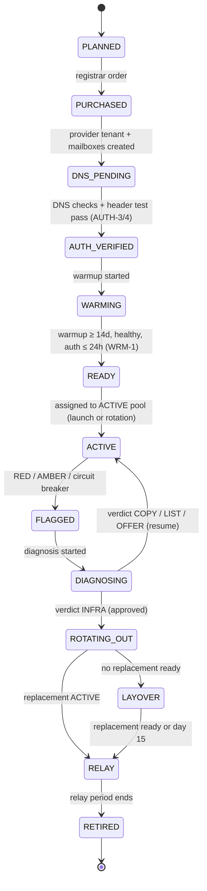
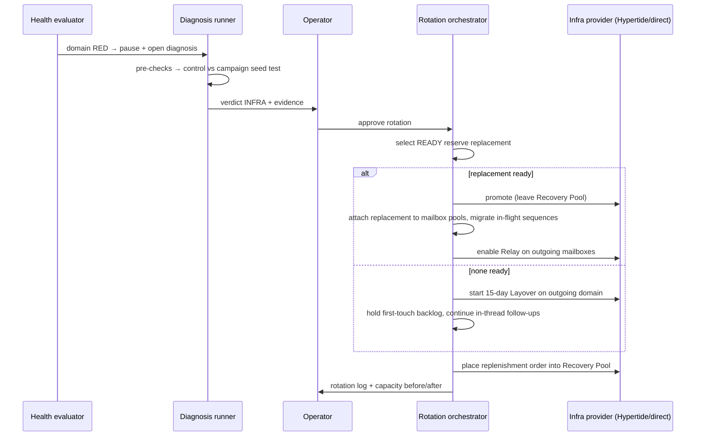
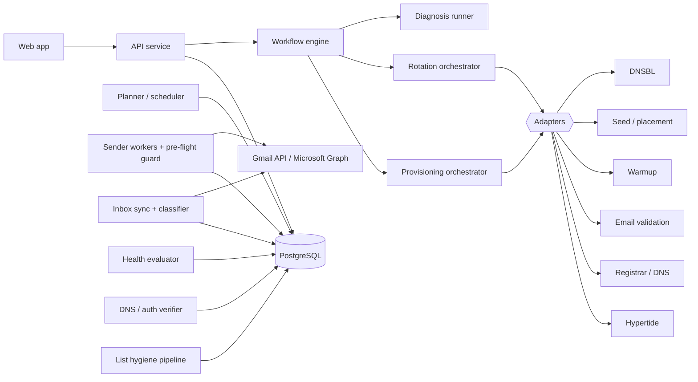

# Cold — Cold Email Deliverability Platform

**Software Specification · v0.1 (Draft for review)**
Date: 2026-11-09 · Status: Draft · Source: *Full Cold Email Deliverability Set-Up* playbook (14 rules, reproduced verbatim in [Appendix B](#appendix-b--source-playbook-verbatim))

---

## 0. How to read this document

- **MUST / SHOULD / MAY** follow RFC 2119.
- Every requirement has an ID (e.g. `AUTH-4`) and a source tag:
  - **[P#n]**: taken directly from playbook rule *n*. These defaults are what the product exists to enforce.
  - **[Proposed]**: a default or mechanism the playbook does not specify, added so the product can be built. Each one is open for review (see [§17](#17-open-questions)).
- **Hard gate** means the system refuses the action and offers no UI or API path around it. **Soft limit** means the action is allowed only with Owner role, a written reason, and an audit entry.
- [Appendix A](#appendix-a--playbook-traceability-matrix) maps each of the 14 playbook rules to the requirements that implement it.

---

## 1. Summary

**Problem.** Cold email programs usually fail because of their infrastructure, and copy is only part of it. Sending domains eventually burn, however careful the team is. When one does, teams lose pipeline in three ways:

1. No warmed replacement is ready, so sending stops for 2–4 weeks.
2. Nobody can tell whether the copy or the infrastructure is at fault, so healthy domains get thrown away or bad copy keeps running.
3. Replies to the burned inboxes get lost during the switch.

**Product.** Cold runs the full deliverability lifecycle as one system:

> protect the primary domain → provision lookalike domains on Google Workspace or Microsoft 365 → authenticate → warm → enforce volume caps → clean lists → lint copy → stagger sends → measure health against baselines → diagnose copy vs. infrastructure → rotate in warmed replacements without stopping and without losing a conversation.

**Design principle.** Cold enforces the playbook as guardrails, not advice. A user cannot send from the primary domain, from an unwarmed inbox, from an unauthenticated domain, above the caps, with a tracking pixel, or to an unvalidated address.

---

## 2. Goals and non-goals

### Goals
| ID | Goal |
|---|---|
| G1 | Make it impossible to break the playbook's safety rules by accident. |
| G2 | Always hold warmed replacement capacity equal to active capacity. |
| G3 | Detect domain degradation from statistically meaningful data, and name the cause: copy, infrastructure, or list. |
| G4 | Rotate infrastructure with no sending gap and no lost conversations. |
| G5 | Make the cost and volume trade-off between Google and Microsoft explicit before any money is spent. |

### Non-goals (v1)
- Sending through generic or third-party SMTP relay providers [P#2].
- Open tracking, click tracking, link rewriting, or HTML templates [P#9, P#10].
- Any cold sending from the primary domain or its subdomains [P#1].
- Lead sourcing or enrichment. Lists are imported.
- A full CRM. Cold exports data and fires webhooks only.
- Newsletters and marketing email.

---

## 3. Users and roles

| Role | Can do |
|---|---|
| **Owner** | Everything, plus billing, policy changes, soft-limit overrides, and auto-rotation settings. |
| **Deliverability Operator** | Provision domains and mailboxes, run auth checks, manage warmup and reserve, run diagnoses, approve rotations. |
| **SDR / Copywriter** | Create campaigns and copy, manage lists, work the unified inbox. Cannot change infrastructure or policies. |
| **Viewer** | Read-only dashboards. |

---

## 4. Glossary

| Term | Meaning |
|---|---|
| **Primary domain** | The brand's real domain (website and employee email). Protected: never used for cold email. |
| **Sending domain** | A separately registered domain that resembles the brand (e.g. `getacme.com` for `acme.com`), used only for cold email. |
| **Mailbox / inbox** | One sending account on a sending domain, hosted on Google Workspace or Microsoft 365. |
| **Microsoft / "Azure"** | Microsoft 365 / Exchange Online mailboxes. The playbook calls these "Azure"; this spec says Microsoft. |
| **Warmup** | Automated low-volume, high-engagement traffic that builds a new mailbox's reputation before cold sending. |
| **Active pool / Reserve pool** | The playbook's "two infrastructure sets". Active domains send. Reserve domains warm, or sit ready, as replacements. |
| **Burned domain** | A domain whose reputation has degraded so much that its mail no longer lands in the inbox. |
| **Catch-all** | A recipient domain that accepts mail for every address, so validation cannot confirm the mailbox exists. |
| **SEG** | Secure Email Gateway, e.g. Proofpoint, Mimecast, Barracuda. These filter cold email aggressively. |
| **Mature send** | A send that is at least 48 hours old, so its replies and bounces have had time to arrive [P#12]. |
| **Baseline** | A domain's normal reply and bounce rates, used for comparison [P#12]. |
| **Control copy** | A neutral, non-commercial message used to separate copy problems from infrastructure problems [P#13]. |
| **Hypertide Recovery Pool** | Hypertide feature: warm replacement infrastructure without paying for it as active infrastructure [P#7]. |
| **Hypertide Relay** | Hypertide feature: keep receiving replies on retired inboxes [P#14]. |
| **Hypertide Layover** | Hypertide feature: a 15-day holding period for outgoing infrastructure while replacements finish warming [P#14]. |

---

## 5. System invariants

The send pipeline enforces these at plan time **and** again in a final pre-flight guard immediately before each send (defense in depth). A violation skips the send with a reason code. These are hard gates.

| # | Invariant | Source |
|---|---|---|
| I-1 | No campaign email is sent from a protected domain or any subdomain of one. | P#1 |
| I-2 | No campaign email is sent from a mailbox hosted anywhere other than Google Workspace or Microsoft 365. | P#2 |
| I-3 | No mailbox exceeds its daily cap, and no domain exceeds its daily cap. | P#4 |
| I-4 | No campaign email is sent from a domain whose SPF, DKIM and DMARC checks have not all passed within the last 24 h. | P#5 |
| I-5 | No campaign email is sent from a mailbox with fewer than 14 days of warmup. | P#6 |
| I-6 | No campaign email goes to an address that is unvalidated, invalid, unknown, suppressed, or behind a blocked SEG. Catch-all addresses go only through catch-all campaigns. | P#8 |
| I-7 | No campaign email contains an HTML part, image, link, attachment, or tracking pixel. | P#9, P#10 |
| I-8 | No inbound message to any non-decommissioned mailbox is dropped. Every reply is stored and threaded. | P#14 |
| I-9 | An opt-out applies globally: across all domains and mailboxes, including domains added in the future. | Compliance |
| I-10 | No prospect receives the same campaign step twice (sending is exactly-once per send ID). | Reliability |

---

## 6. Functional requirements

### 6.1 Domain protection and sending domains [P#1]

| ID | Requirement |
|---|---|
| DOM-1 | **[P#1]** The workspace MUST register at least one **primary domain** as protected. The system MUST refuse to create or connect a sending mailbox on a protected domain or its subdomains, and MUST refuse any campaign send whose `From`, envelope sender (`Return-Path`), or DKIM `d=` is protected. *Rationale:* subdomains share the parent domain's reputation, so they get the same protection. |
| DOM-2 | **[P#1]** **Domain name generator.** Given brand tokens and the primary domain, propose lookalike names with patterns such as `{get,try,use,hello,meet,join}{brand}` and `{brand}{hq,team,app,labs,mail}`. Check availability and price through the registrar adapter. Rank `.com` first, and penalize hyphens, digits, and length over 20 characters. The generator MUST NOT build names from any brand other than the workspace's own. |
| DOM-3 | Domains are bought through a registrar adapter, or imported if bought elsewhere (ownership is proven through DNS access). |
| DOM-4 | **[Proposed]** The root and `www` of every sending domain SHOULD 301-redirect to the primary website, so a prospect who visits finds the real brand. |
| DOM-5 | Track registrar, purchase date, expiry, and auto-renew for every domain. Alert 30 days before expiry for any domain in the active or reserve pool. |
| DOM-6 | Show domain age, and days in active service, on every domain view. |

### 6.2 Mailbox providers [P#2, P#3]

| ID | Requirement |
|---|---|
| PRV-1 | **[P#2]** Supported sending providers: **Google Workspace** and **Microsoft 365**. Resellers that provision genuine Google or Microsoft mailboxes (e.g. Hypertide) are supported through an infrastructure adapter. The underlying provider is recorded on each mailbox. |
| PRV-2 | **[P#2]** Generic SMTP relay providers MUST NOT be configurable for campaign sending. Mail goes out only through the provider's native API (Gmail API, Microsoft Graph) or the provider's own SMTP endpoint authenticated with OAuth (`smtp.gmail.com`, `smtp.office365.com`). |
| PRV-3 | A sending domain has exactly one provider. MX, SPF and DKIM are provider-specific, so Google and Microsoft mailboxes never share a domain. |
| PRV-4 | Mailbox provisioning sets the persona (first and last name, local-part pattern such as `first@` or `first.last@`), display name, and a plain-text signature validated by the copy linter (CPY-4). A profile photo is optional. |
| PRV-5 | Mailboxes connect via OAuth: Google domain-wide delegation through a service account; Microsoft app-only auth with `Mail.Send` and `Mail.ReadWrite`, scoped to the sending mailboxes. Connection health is checked every 15 min. A failure sets the mailbox to `DISCONNECTED`, which removes it from scheduling. |
| PRV-6 | **[P#3]** The capacity planner (CAP-6) shows both providers side by side: Microsoft is typically **5–6× cheaper** per unit of sending capacity, and Google is **easier to manage**. The ratio is computed from current price inputs and is not hard-coded. |

### 6.3 Capacity planning and volume caps [P#3, P#4, P#7]

**Default caps [P#4]**

| Provider | Mailboxes per domain | Campaign sends per mailbox per day | Campaign sends per domain per day |
|---|---|---|---|
| Google Workspace | 3 | 15 | **45** |
| Microsoft 365 | 1 – 50 | 3 | **150** (`= mailboxes × 3`, max 150) |

| ID | Requirement |
|---|---|
| CAP-1 | **[P#4]** The defaults above apply to every domain. The domain cap is `min(domain_cap_policy, mailboxes × mailbox_cap)`. |
| CAP-2 | Caps are enforced twice: the planner never schedules past them, and the sender atomically increments a `(mailbox, local_date)` counter before each send. The day boundary is the mailbox's configured timezone. |
| CAP-3 | Caps count every campaign email (first touches and follow-ups), diagnosis seed sends (DGN-3), and manual new outbound written in Cold. Caps do **not** count warmup traffic or replies inside threads where the prospect has replied. |
| CAP-4 | Lowering a cap is always allowed. Raising one above the playbook default is a **soft limit**: Owner role, a written reason, an audit entry, and a permanent "off-playbook" badge on the domain. |
| CAP-5 | Microsoft domains may hold 1–50 mailboxes. The planner defaults to 50. |
| CAP-6 | **[P#3, P#4, P#7] Capacity planner.** Inputs: target daily volume, provider, sending days (Mon–Fri, optionally Sat), reserve ratio (default 1.0), and price inputs. Outputs, per provider and side by side: active and reserve domains and mailboxes, monthly cost, cost per 1,000 sends, lead time to first send, and the days one domain needs to reach the 1,000-send measurement threshold. Formulas in [§8.1](#81-capacity-planner). |
| CAP-7 | The fleet dashboard shows active capacity (sum of domain caps), planned volume, utilization, and reserve coverage (RSV-2). |

### 6.4 Authentication [P#5]

**Expected DNS records** (Cold generates these for each domain):

| Record | Google Workspace | Microsoft 365 |
|---|---|---|
| MX | `smtp.google.com` (priority 1), or the legacy `ASPMX` set | Tenant-provided `*.mail.protection.outlook.com` (or `*.mx.microsoft`) |
| SPF (`TXT @`) | `v=spf1 include:_spf.google.com ~all` | `v=spf1 include:spf.protection.outlook.com -all` |
| DKIM | `TXT google._domainkey`, a 2048-bit key generated in the Admin console | `CNAME selector1._domainkey` and `selector2._domainkey` → tenant-provided targets, then signing enabled in the tenant |
| DMARC (`TXT _dmarc`) | `v=DMARC1; p=none; rua=mailto:<reports>` (policy configurable) | Same |

| ID | Requirement |
|---|---|
| AUTH-1 | **[P#5]** Generate the expected record set for each domain from its provider and tenant data. The SPF qualifier (`~all` or `-all`) and the DMARC policy are workspace settings. |
| AUTH-2 | When DNS runs through a supported DNS adapter, write records automatically. Otherwise show copy-paste instructions and poll until they resolve. Where the provider exposes no API (e.g. Google DKIM key generation), present a guided manual step, then verify the result. |
| AUTH-3 | **[P#5] DNS verification** passes only when: there is exactly one SPF record, it includes the provider, and it needs ≤ 10 DNS lookups; the DKIM key resolves and parses (for Microsoft, signing is also enabled); there is exactly one DMARC record and its syntax is valid; MX points at the domain's provider. Check against at least two public resolvers. |
| AUTH-4 | **[P#5] Header test** ("send yourself a test email and inspect the headers"). After DNS passes, every mailbox sends a test message to Cold's seed mailboxes (at least one Google-hosted, one Microsoft-hosted). Cold fetches each delivered copy, parses `Authentication-Results`, and requires **`spf=pass`**, **`dkim=pass` with `header.d` aligned to the sending domain**, and **`dmarc=pass`**. Raw headers are stored and shown in the UI. The landing folder is recorded too, for information only. |
| AUTH-5 | **Gate:** a domain cannot enter `WARMING` until DNS verification passes and every mailbox passes the header test. |
| AUTH-6 | **Continuous re-verification.** DNS checks run every 24 h and immediately before promotion to `ACTIVE`. The header test re-runs weekly and after any DNS change. A failure sets the domain to `AUTH_FAILED`, pauses campaign sending and warmup, and raises an alert. The domain returns to its prior state once checks pass again. |
| AUTH-7 | **[Proposed]** Check sending domains daily against domain blocklists (e.g. Spamhaus DBL, SURBL) through a DNSBL adapter. A listing flags the domain (HLT-8). |

### 6.5 Warmup [P#6]

| ID | Requirement |
|---|---|
| WRM-1 | **[P#6]** A mailbox MUST complete **at least 14 days** of warmup before any campaign send. This is a hard floor: policy may raise it but never lower it. The recommended target is **30 days**. Mailboxes show **Ready (minimum)** at 14–29 days and **Ready (recommended)** at 30+ days. |
| WRM-2 | Warmup age counts only days on which warmup was running and reported healthy. Paused days do not count. |
| WRM-3 | Warmup runs through a warmup-provider adapter: start, pause, resume, set volume, and read metrics (sent, received, inbox rate and spam rate where the provider exposes them). |
| WRM-4 | **[Proposed]** Where the provider reports placement, a mailbox needs a trailing-7-day warmup inbox rate of at least 90% to become `READY`. |
| WRM-5 | **[Proposed]** Warmup continues on active mailboxes by default. Its volume does not count toward cold caps. |
| WRM-6 | **[P#6]** "Never start sending immediately": a mailbox that isn't `READY` cannot be assigned to a campaign. The UI shows a countdown ("Ready in 9 days") instead of an assign button. |

### 6.6 Infrastructure sets and reserve [P#7]

| ID | Requirement |
|---|---|
| RSV-1 | **[P#7]** Every domain sits in exactly one pool: **ACTIVE** (sending), **RESERVE** (warming or ready, not sending), or **RETIRED**. The playbook's "two infrastructure sets" are these two live pools. Pools are used instead of fixed sets because, after rotation, the domains in each set mix. |
| RSV-2 | **Reserve coverage** = cap of `READY` reserve domains ÷ cap of `ACTIVE` domains, per provider. The target is **100%** (reserve ratio 1.0). The dashboard also shows the warming pipeline: reserve domains still warming, each with its ready ETA. |
| RSV-3 | Raise a warning when coverage drops below target, and a critical alert below 50% **[Proposed]**. |
| RSV-4 | **Auto-replenish.** When a domain leaves ACTIVE, or a reserve domain is promoted, Cold creates a like-for-like provisioning order into RESERVE. The order is a draft by default, or executes automatically if policy allows. |
| RSV-5 | **[P#7] Hypertide Recovery Pool.** Reserve domains provisioned through Hypertide go into the Recovery Pool, so they warm without being billed as active. Promotion moves them out through the adapter. Each domain's billing status (`active`, `recovery_pool`, `layover`, `relay`, `cancelled`) is stored and used in cost views. |
| RSV-6 | **Initial launch.** The planner provisions both pools together and both start warming on day 0. The ACTIVE pool starts sending once warmup completes. The RESERVE pool keeps warming. |

### 6.7 List hygiene [P#8]

Pipeline, in order: **import → normalize and dedupe → suppression → validation → MX classification → segmentation → report**. Nothing can be enrolled until the pipeline has finished for that import.

| ID | Requirement |
|---|---|
| LST-1 | Import from CSV or the API, with field mapping. Required: `email`. Optional: first name, company, title, timezone, country, segment tags (`smb`, `mid_market`, `enterprise`, …), and custom merge fields. |
| LST-2 | Normalize (trim; lowercase the domain), dedupe within the import, and block enrolling a prospect who is already in an active sequence anywhere in the workspace. |
| LST-3 | Apply global suppression: opt-outs, prior hard bounces, complaints, do-not-contact domains (customers, partners, competitors), and the workspace's own domains. |
| LST-4 | **[P#8] Validate every address** through the validation adapter. Results: `valid`, `invalid`, `catch_all`, `unknown`, `disposable`, plus a `role` flag. **[Proposed]** Results expire after 30 days, and an expired result triggers re-validation before the address can send. A recipient domain with no MX record counts as `invalid`. |
| LST-5 | **[P#8] Separate catch-alls.** `catch_all` addresses go into their own segment, which only campaigns flagged *catch-all* can enroll. Those campaigns draw from a dedicated catch-all mailbox pool by default, so catch-all bounces cannot damage the core domains. Catch-all metrics are reported separately. |
| LST-6 | **[P#8] Remove SEG-protected prospects.** Resolve MX per recipient domain (cached for 7 days) and match against the SEG patterns: Proofpoint `*.pphosted.com`, `*.ppe-hosted.com`; Mimecast `*.mimecast.com`; Barracuda `*.barracudanetworks.com`. Matches move to a **Blocked: SEG** bucket that can be exported for other channels. Patterns are configurable, and more gateways (e.g. Cisco `*.iphmx.com`) can be added. |
| LST-7 | **[P#8] Recipient-provider classification.** Classify each recipient as Google (`smtp.google.com`, `aspmx.l.google.com`, `*.googlemail.com`), Microsoft (`*.mail.protection.outlook.com`, `*.mx.microsoft`), or Other. The import report shows the mix. **[Proposed]** Warn when one provider is more than 80% of a list. Scheduling mixes providers (SCH-6). |
| LST-8 | `invalid`, `unknown` and `disposable` are excluded by default. **[Proposed]** `unknown` may optionally be routed with catch-alls. |
| LST-9 | Each import produces a hygiene report: counts per outcome (valid, catch-all, invalid, unknown, suppressed, SEG-blocked, duplicate), plus the recipient-provider mix. |

### 6.8 Copy and linter [P#9]

| ID | Requirement |
|---|---|
| CPY-1 | **[P#9]** Campaign email is plain text only: one `text/plain; charset=UTF-8` MIME part. No HTML part, images, attachments, or formatting. |
| CPY-2 | **[P#9]** A copy linter runs on every variant and every rendered message. Rules are in the table below. |
| CPY-3 | A campaign cannot launch with any **Block** finding. **Warn** findings each need an explicit acknowledgment, which is recorded. |
| CPY-4 | **[P#9]** Signatures are plain text: at most 3 lines **[Proposed]**, no links, images, or logos. A jurisdiction-required postal address line is allowed and does not count toward the limit (CMP-2). |
| CPY-5 | Each sequence step supports several variants for A/B testing, and optional spintax. Every resolved spintax output is linted. |
| CPY-6 | **[P#13] Control copy library.** The workspace keeps at least one neutral control message (short, plain, non-commercial) for diagnosis. Cold ships defaults. |
| CPY-7 | The linter runs live in the editor, on save through the API, and in the pre-flight guard on the fully rendered message. |
| CPY-8 | Each step may define a **standalone variant**: a version that makes sense without the earlier emails, used when a sequence moves to a new mailbox during rotation (ROT-4). |

**Linter rules**

| Rule | Severity | Source |
|---|---|---|
| Any URL or bare domain (`http`, `www.`, `name.tld`) in subject, body or signature | Block | P#9 |
| HTML tags, Markdown formatting, images, attachments | Block | P#9 |
| Unresolved merge field, or a merge field with no fallback | Block | Proposed |
| First-touch subject starting with `Re:` or `Fwd:` (deceptive) | Block | Compliance |
| Missing opt-out line when the jurisdiction profile requires one | Block | Compliance |
| Body longer than 100 words (Warn) or 150 words (Block) | Warn / Block | P#9 (limits Proposed) |
| Signature longer than 3 lines | Warn | P#9 |
| Corporate-language phrase list ("synergy", "leverage", "best-in-class", "I hope this email finds you well", …; editable) | Warn | P#9 |
| Hard CTA (meeting length, "book a call", "schedule a demo", calendar language) where no soft CTA is present | Warn | P#9 |
| No question-form soft CTA ("Interested?", "Worth a chat?", "Open to it?") | Warn | P#9 |
| Spam-trigger list (e.g. "free", "guarantee", "act now"), ALL-CAPS words, more than one `!` | Warn | Proposed |

### 6.9 Tracking policy [P#10]

| ID | Requirement |
|---|---|
| TRK-1 | **[P#10]** Open-tracking pixels are not supported, and no setting exists to turn them on. |
| TRK-2 | Click tracking and link rewriting are not supported. Links are blocked by CPY-2 anyway. |
| TRK-3 | **[P#10]** Cold reports sent, delivered (`sent − bounced`), human replies, positive replies, hard and soft bounces, opt-outs, and auto-replies. "Open rate" appears nowhere in the UI or API. |

### 6.10 Scheduling and sending [P#11]

| ID | Requirement |
|---|---|
| SCH-1 | **[P#11]** Default sending window: **Mon–Fri, 08:00–17:00 in the recipient's local time**. Local time comes from the prospect's timezone field, else is inferred from country or state, else falls back to the campaign default. *(The hours are Proposed.)* |
| SCH-2 | **[P#11] Randomized start.** Each day, each mailbox draws a start offset uniformly from `[0, start_jitter_max]` (default 90 min **[Proposed]**) after its window opens. No two mailboxes on the same domain start in the same minute. |
| SCH-3 | **[Proposed] Spacing.** A mailbox's sends spread across its remaining window: base gap = remaining window ÷ remaining sends, each gap jittered by ±40%, minimum 7 min. |
| SCH-4 | **[Proposed] Fleet smoothing.** At most 1 send per minute per domain, and a configurable workspace-wide rate, so no burst ever fires across the fleet. |
| SCH-5 | **[P#11] Saturday sending.** A per-campaign toggle, off by default. **Saturday test mode** (offered for segments tagged `smb` or `mid_market`) moves a configurable share of weekly first touches to Saturday and reports Saturday vs. weekday reply rates with sample sizes. Daily caps still apply on Saturday. |
| SCH-6 | **[P#8] Recipient-provider mixing.** Daily assignment interleaves recipient providers so each domain's batch matches the eligible pool's mix. No domain gets a day of only Microsoft or only Google recipients. |
| SCH-7 | **Sequences.** Steps have delays in business days. Follow-ups go in-thread (`In-Reply-To` and `References` headers) from the same mailbox. A sequence stops on a human reply, hard bounce, or opt-out. **[Proposed]** An out-of-office reply pauses the sequence until the stated return date (default 7 days). |
| SCH-8 | **[Proposed]** At most one first touch per recipient company domain per sending domain per day, and at most 3 contacts per company per week across the workspace (configurable). |
| SCH-9 | **Pre-flight guard.** Immediately before sending, re-check every invariant in §5. A failure skips the send with a reason code (`CAP_EXCEEDED`, `AUTH_STALE`, `SUPPRESSED`, `LINT_BLOCK`, …) and does not retry blindly. |
| SCH-10 | **Transport.** Gmail API `users.messages.send` or Microsoft Graph `sendMail`. Store the provider message ID and the RFC `Message-ID`. A unique `send_id` constraint ensures exactly-once sending. |
| SCH-11 | **Errors.** Transient errors (429, 5xx) retry with backoff inside the window. A provider throttling or suspension signal pauses the mailbox and alerts. |
| SCH-12 | **[Proposed]** Optionally skip public holidays per recipient country. |

### 6.11 Inbox, replies and bounces [P#10, P#14]

| ID | Requirement |
|---|---|
| INB-1 | Sync every mailbox that is not decommissioned: Gmail `users.watch` with Pub/Sub push, or Graph change notifications, plus a 5-minute delta sync as a backstop. Warmup traffic is recognized and excluded. |
| INB-2 | Classify inbound mail as one of: **human reply** (sub-labels: positive, question, not interested, referral, opt-out request); **auto-reply** (`Auto-Submitted`, `X-Autoreply`, `Precedence`, out-of-office patterns); **bounce** (DSN parsing, `multipart/report`); or **warmup**. |
| INB-3 | **Unified inbox.** Every thread from every mailbox in one view, filterable by campaign, domain, mailbox state and classification. Replying from Cold sends from the original mailbox, in-thread, including mailboxes in `FLAGGED`, `LAYOVER` or `RELAY`. |
| INB-4 | **[P#14] Conversations are permanent.** Threads and messages are stored in Cold and kept regardless of what happens to the mailbox. Retiring or decommissioning a mailbox never deletes a conversation. |
| INB-5 | **Bounces.** A hard bounce (5.x.x) suppresses the address globally and counts toward bounce rate. Soft bounces (4.x.x) are tracked separately. Each bounce is categorized: `user_unknown` (5.1.1), `mailbox_full`, `policy_or_spam_block` (5.7.x), `domain_not_found`, `other`. Diagnosis uses these categories (DGN-2). |
| INB-6 | An **opt-out request** suppresses the address globally right away. Ambiguous cases go to a human review queue (24 h SLA), and the sequence pauses meanwhile. |
| INB-7 | A positive reply sends a Slack or email notification and a CRM webhook. |

### 6.12 Health measurement [P#10, P#12]

**Definitions** (computed per evaluation scope):

- `sends(W)`: campaign emails sent in window `W` (first touches and follow-ups; seed sends excluded).
- `bounce_rate(W)` = hard bounces attributed to sends in `W` ÷ `sends(W)`
- `reply_rate(W)` = human replies attributed to sends in `W` ÷ `sends(W)`. Each reply is attributed to the latest message Cold sent in that thread. Negative replies and opt-outs count as replies, since they still prove inbox placement. Auto-replies do not.

| ID | Requirement |
|---|---|
| HLT-1 | **[P#10, P#12]** Health is measured with reply rate and bounce rate only. |
| HLT-2 | **[P#12] Minimum sample.** No verdict that can trigger action is issued on fewer than **1,000 sends**. |
| HLT-3 | **[P#12] Maturity.** A send counts only once it is **≥ 48 h old**. The window is the most recent 1,000 mature sends. |
| HLT-4 | **Evaluation scopes.** **Domain** is the primary scope and can trigger action. **Campaign × provider pool** can trigger action and is used for copy signals. **Mailbox** is for information only. A Google domain sends at most 45/day, so its window covers about 23 sending days. The window grows backward until it holds 1,000 sends, with a 60-day lookback cap **[Proposed]**; if it hits the cap first, the domain reads `INSUFFICIENT_DATA`. |
| HLT-5 | **[P#12] Baseline.** The median reply and bounce rates over the domain's last 3 non-overlapping `GREEN` windows. Until a domain has its own, it uses a **cohort baseline**: the median of same-provider active domains on the same campaigns. |
| HLT-6 | **[P#12] Verdicts.** **RED:** `reply_rate < 1%` **and** `bounce_rate > 3%`; automatically pauses the domain's campaign sends and opens a diagnosis. **AMBER:** exactly one of those thresholds breached, **or [Proposed]** reply rate below 50% of baseline, or bounce rate above baseline + 2 pp; recommends a diagnosis. **GREEN:** neither. **INSUFFICIENT_DATA:** under 1,000 mature sends. |
| HLT-7 | Evaluate hourly. A verdict change emits an event. History is stored for charts that show each rate against its baseline band. |
| HLT-8 | **[Proposed] Circuit breakers.** These are safety pauses that skip the sample rule but never produce a rotation verdict: (a) a provider suspension or block on a mailbox pauses that mailbox; (b) a list batch with hard-bounce rate above 5% after at least 200 sends pauses that list's enrollments (a list problem); (c) three or more `policy_or_spam_block` bounces on one domain within 24 h, or a blocklist hit (AUTH-7), pause the domain and open a diagnosis. |
| HLT-9 | After a diagnosis closes with the domain resumed, its next verdict that can trigger action uses only sends made after the resume, so it cannot loop on stale data. |
| HLT-10 | **[Proposed] Correlated flags.** If 30% or more of a campaign's active domains go RED or AMBER within 72 h, open one campaign-level diagnosis first. Simultaneous failures point to copy or list, not to every domain burning at once. |

### 6.13 Diagnosis [P#13]

| ID | Requirement |
|---|---|
| DGN-1 | **[P#13] Diagnose before replacing.** A rotation (ROT) needs a completed diagnosis with verdict `INFRA`. The only exceptions are hard evidence: a blocklist listing or a provider suspension. |
| DGN-2 | **Automated pre-checks**, run within minutes: (1) re-verify auth (failure → verdict `AUTH`: fix it, don't replace the domain); (2) look up blocklists; (3) analyze bounce composition: mostly `user_unknown` points to the list, mostly `policy_or_spam_block` points to infrastructure; (4) check list quality (validation age, catch-all share). |
| DGN-3 | **[P#13] Control test.** From the same mailboxes as the flagged domain (up to 3), send **(a)** the neutral control message and **(b)** the campaign's current message, rendered for a real prospect, to a **seed panel**: at least 4 seeds each across Gmail, Google Workspace, Outlook.com and Microsoft 365, plus optional SEG-protected seeds. Send order is randomized, sends are at least 5 min apart, and seed sends count toward caps. |
| DGN-4 | **Placement read.** Between 30 min and 4 h after sending, read every seed through its API and record the folder: Inbox (Primary, Focused or Other), Promotions, Spam/Junk, or Not received. A message **passes** when Spam plus Not received is at most 20% of seeds **[Proposed]**. |
| DGN-5 | **[P#13] Decision table.** See below. |
| DGN-6 | Each diagnosis stores its evidence (pre-check results, headers, seed placements, bounce samples), verdict and recommended action. An Operator may override the verdict with a reason, which is audited. |
| DGN-7 | **[Proposed]** Optional live A/B mode: split the next sends from the same mailboxes evenly between control copy and campaign copy to real prospects, then compare reply rates under HLT-2 and HLT-3. It is slower and is offered only as a tie-breaker. |

**Decision table [P#13]**

| Control copy | Campaign copy | Verdict | Action |
|---|---|---|---|
| Pass | Fail | **COPY** | Rewrite. Pause the failing variant, open it in the editor with lint results, keep the infrastructure, resume the domain. |
| Fail | Fail | **INFRA** | Replace the infrastructure: start a rotation (§6.14). |
| Pass | Pass | **LIST** or **OFFER** | Not a placement problem. If bounces are mostly `user_unknown`: verdict LIST (re-validate, tighten filters). Otherwise: verdict OFFER (review targeting and offer). Resume the domain. |
| Fail | Pass | **INCONCLUSIVE** | Re-run once automatically. If it repeats, an Operator decides, with the evidence shown. |

### 6.14 Rotation [P#14]

| ID | Requirement |
|---|---|
| ROT-1 | **[P#14] Make before break.** A domain leaves ACTIVE only after its replacement is ACTIVE. The one exception is an explicit Operator decision to accept the capacity loss. |
| ROT-2 | **Replacement selection.** A `READY` reserve domain with the same provider, auth verified within 24 h, warmup at the minimum or more (longest-warmed first, 30+ days preferred), healthy warmup metrics, and at least as much capacity. |
| ROT-3 | **Promotion.** Reserve → ACTIVE. For Hypertide, the domain also leaves the Recovery Pool through the adapter. Campaigns send through **mailbox pools**, not fixed mailboxes, so the replacement simply joins the outgoing domain's pools and no campaign needs editing. |
| ROT-4 | **[P#14] Outgoing domain, with a replacement ready.** The outgoing domain moves to `RELAY` and stops cold sends. For in-flight sequences without a reply, the next step moves to a replacement mailbox as a new thread using the step's standalone variant (CPY-8). If no standalone variant exists, the sequence ends and the prospect becomes eligible to re-enroll after a 30-day cooldown **[Proposed]**. |
| ROT-5 | **[P#14] Outgoing domain, no replacement ready → Layover.** The outgoing domain enters `LAYOVER` for up to **15 days** (Hypertide Layover, or a native equivalent). During layover: no new first touches; follow-ups to prospects already in a sequence continue in their original threads; replies continue. First-touch volume waits in a backlog. When a replacement becomes READY, or on day 15, whichever comes first, the outgoing domain moves to `RELAY` and the backlog drains to the replacement. *(Layover semantics must be confirmed with Hypertide; see §17.)* |
| ROT-6 | **[P#14] Relay.** Hypertide Relay keeps receiving replies at the outgoing addresses and delivers them into Cold's unified inbox, threaded to the original conversation. Users can still answer in-thread. **Native fallback** for non-Hypertide infrastructure: keep the mailboxes connected in receive-and-reply-only mode. Relay lasts 90 days by default **[Proposed]**, after which the mailboxes are decommissioned. Conversations stay in Cold permanently (INB-4). |
| ROT-7 | **Approval.** By default an Operator approves with one click from the diagnosis. Owners can enable an "auto-rotate on INFRA verdict" policy. |
| ROT-8 | **Replenish.** Every rotation creates a replenishment order (RSV-4). |
| ROT-9 | **Carry-over.** Suppression, conversation history and prospect state live at workspace level, so every opt-out from a burned domain stays enforced (I-9). |
| ROT-10 | **Rotation log.** Records trigger, diagnosis, approver, outgoing and replacement domains, capacity before and after, prospects migrated, sequences ended, and threads kept in relay. Target: execution finishes within 15 min of approval, excluding provider-side latency. |

### 6.15 Compliance

Cold provides the controls below. It does not give legal advice; each workspace's sending program needs its own legal review.

| ID | Requirement |
|---|---|
| CMP-1 | Global suppression across all domains and mailboxes, checked at enrollment and again at send (I-9). |
| CMP-2 | **Jurisdiction profiles,** chosen per campaign by recipient country. Each defines the required elements: e.g. US CAN-SPAM (accurate headers, a non-deceptive subject, a valid postal address, an opt-out honored within 10 business days); EU and UK GDPR and PECR; Canada CASL. The linter enforces each profile's required lines. Opt-out works by reply ("just reply 'no' and I won't follow up"), so it needs no links. |
| CMP-3 | **Sender identity.** Display names map to real, accountable people at the sending business. Sending domains must be owned by that business and must never imitate a third party's brand. |
| CMP-4 | Prospect PII is encrypted at rest. An erasure request deletes the PII and keeps a hashed suppression entry, so the person is never emailed again. |

### 6.16 Notifications

Delivered by email and Slack, with per-user subscriptions. Events: health RED or AMBER; diagnosis completed; rotation needed, approved or executed; reserve coverage low; auth failure; mailbox disconnected or suspended; blocklist hit; circuit breaker tripped; positive reply; domain nearing expiry; replenishment order ready.

---

## 7. Lifecycle state machines

### 7.1 Sending domain



`AUTH_FAILED` can be entered from `WARMING`, `READY`, `ACTIVE` or `FLAGGED` when re-verification fails (AUTH-6). It blocks sending and warmup, and the domain returns to its previous state once checks pass.

**Transition guards (hard gates):** `→ WARMING` requires AUTH-5. `→ READY` requires WRM-1, WRM-4 and auth re-verified within 24 h. `→ ACTIVE` requires `READY` (no skipping) and a non-protected domain. `→ ROTATING_OUT` requires DGN-1.

### 7.2 Mailbox

`PROVISIONING → AUTH_VERIFIED → WARMING → READY → ACTIVE → (PAUSED) → RELAY → DECOMMISSIONED`, plus the orthogonal flags `DISCONNECTED` (OAuth failure) and `SUSPENDED` (provider action). A mailbox can never be in a later lifecycle stage than its domain.

---

## 8. Key algorithms

### 8.1 Capacity planner

```
per_domain_daily  = mailboxes_per_domain × per_mailbox_daily          # Google 3×15=45, Microsoft 50×3=150
active_domains    = ceil(target_daily / per_domain_daily)
reserve_domains   = ceil(active_domains × reserve_ratio)               # default ratio 1.0 [P#7]
active_mailboxes  = active_domains  × mailboxes_per_domain
reserve_mailboxes = reserve_domains × mailboxes_per_domain
sending_days_pm   = 21.7 (Mon–Fri) or 26 (Mon–Sat)
monthly_sends     = target_daily × sending_days_pm

monthly_cost = active_mailboxes  × price_mailbox_active
             + reserve_mailboxes × price_mailbox_reserve               # Recovery Pool price, may be 0
             + (active_domains + reserve_domains) × (price_domain_per_year / 12 + tenant_fee_per_domain)
             + warmup_cost + validation_cost(new_prospects_pm)
cost_per_1k  = monthly_cost / monthly_sends × 1000
lead_time    = provisioning_days + warmup_min_days (14; 30 recommended)
days_to_first_verdict(domain) = ceil(1000 / per_domain_daily) + 2      # 48h maturity
```

**Worked example: target 1,000 sends per business day** (prices left out on purpose; they are inputs)

| | Google Workspace | Microsoft 365 |
|---|---|---|
| Daily capacity per domain | 45 | 150 |
| Active domains / mailboxes | 23 / 69 | 7 / 350 |
| Reserve domains / mailboxes | 23 / 69 | 7 / 350 |
| **Total domains / mailboxes** | **46 / 138** | **14 / 700** |
| Actual daily capacity | 1,035 | 1,050 |
| Monthly sends (Mon–Fri) | ≈ 21,700 | ≈ 21,700 |
| First send after purchase | ≥ 14 days warmup (30 recommended) | Same |
| Sending days for one domain to reach 1,000 sends | 23 (+48 h) | 7 (+48 h) |

### 8.2 Daily planning and scheduling

Runs every 15 minutes over a rolling 24-hour horizon, and is idempotent.

```
for each workspace:
  M = mailboxes where mailbox.state = ACTIVE and domain.state = ACTIVE
        and auth_verified_within(24h) and warmup_days ≥ policy.min and connected
  for m in M:
    m.remaining = min(m.cap − sent_today(m), share_of(domain_remaining(m.domain)))

  # 1. Follow-ups first: they must leave from their original mailbox (thread continuity).
  for step in due_followups ordered by due_at:
    assign to step.enrollment.mailbox if remaining > 0, else carry over to next business day

  # 2. First touches fill the remaining capacity.
  for pool in mailbox_pools:
    candidates = next eligible prospects of campaigns using this pool
                 (catch-all prospects only in catch-all pools)       # LST-5
    buckets    = group candidates by recipient_provider               # LST-7
    interleave buckets by largest-remainder to match the eligible mix # SCH-6
    enforce per-company limits                                        # SCH-8
    distribute across mailboxes by remaining capacity

  # 3. Timing.
  for m in M:
    start  = window_open(m) + uniform(0, jitter_max)                  # SCH-2, re-drawn daily
    slots  = spread remaining sends to window_close with ±40% jitter, min gap 7 min   # SCH-3
    each send goes into a slot where the recipient's local time is inside its window   # SCH-1
  apply fleet smoothing (≤ 1 send/min/domain)                         # SCH-4
  persist Send rows with a unique send_id; the sender worker runs the pre-flight guard   # SCH-9
```

### 8.3 Health evaluation

```
def evaluate(domain, now):
    since  = domain.last_resume_at or domain.activated_at                 # HLT-9
    mature = sends(domain) where since ≤ sent_at ≤ now − 48h              # HLT-3
             and sent_at ≥ now − 60d, newest first
    W = first 1000 of mature
    if len(W) < 1000: return INSUFFICIENT_DATA                            # HLT-2
    rr = human_replies(W) / len(W);  br = hard_bounces(W) / len(W)
    if rr < 0.01 and br > 0.03:  return RED                               # HLT-6 [P#12]
    B = baseline(domain) or cohort_baseline(domain)                       # HLT-5
    if rr < 0.01 or br > 0.03 or rr < 0.5 * B.rr or br > B.br + 0.02:
        return AMBER
    return GREEN
```

### 8.4 Rotation sequence



---

## 9. Data model (core entities)

| Entity | Key fields |
|---|---|
| `Workspace` | id, name, default_timezone, policies (JSON, see §14) |
| `User`, `Membership` | user_id, workspace_id, role |
| `ProtectedDomain` | id, workspace_id, domain |
| `SendingDomain` | id, workspace_id, name, provider (`google`/`microsoft`), infra_vendor (`hypertide`/`direct`), pool (`active`/`reserve`/`retired`), state, billing_status, registrar, purchased_at, expires_at, auto_renew, dns_managed, forwarding_target, activated_at, last_resume_at, retired_at, retire_reason, cap_override |
| `Mailbox` | id, domain_id, address, display_name, persona_id, provider_user_id, state, connection_status, timezone, warmup_started_at, warmup_effective_days, cap_override, pool_ids |
| `MailboxPool` | id, workspace_id, name, provider, is_catch_all |
| `DnsCheck` | id, domain_id, checked_at, results (per record), pass |
| `HeaderTest` | id, mailbox_id, seed_id, sent_at, received_at, raw_headers, spf, dkim, dkim_d, dmarc, folder, pass |
| `WarmupMetric` | mailbox_id, date, sent, received, inbox_rate, spam_rate |
| `ListImport` | id, workspace_id, source, counts by outcome, provider_mix, completed_at |
| `Prospect` | id, workspace_id, email, names, company, company_domain, title, timezone, country, segment_tags, recipient_provider, seg_vendor, validation_status, validated_at, custom_fields |
| `Suppression` | id, workspace_id, email_hash, email (nullable after erasure), domain (nullable), reason, source, created_at |
| `Campaign` | id, workspace_id, name, mailbox_pool_id, is_catch_all, schedule (window, days, saturday, saturday_test_share), jurisdiction_profile, status |
| `SequenceStep` | id, campaign_id, position, delay_business_days, thread_mode |
| `CopyVariant` | id, step_id, subject, body, standalone_body, lint_findings, acknowledged_warnings, status |
| `ControlMessage` | id, workspace_id, subject, body |
| `Enrollment` | id, prospect_id, campaign_id, mailbox_id, thread_id, current_step, status (`active`/`replied`/`bounced`/`opted_out`/`completed`/`interrupted`), reenroll_after |
| `Send` | id (unique send_id), enrollment_id, step_id, variant_id, mailbox_id, domain_id, scheduled_at, sent_at, status, skip_reason, provider_message_id, rfc_message_id, kind (`campaign`/`seed`/`header_test`), diagnosis_id |
| `Thread`, `Message` | thread: id, mailbox_id, prospect_id, enrollment_id · message: id, thread_id, direction, headers, body_text, received_at, classification |
| `Bounce` | id, send_id, type (`hard`/`soft`), enhanced_status, category, raw |
| `HealthWindow` | id, scope_type, scope_id, first_send_at, last_send_at, sends, hard_bounces, human_replies, reply_rate, bounce_rate, baseline_rr, baseline_br, verdict, evaluated_at |
| `Diagnosis` | id, domain_id, campaign_id, trigger, prechecks, control_result, campaign_result, verdict, action, decided_by, override_reason, opened_at, closed_at |
| `SeedMailbox`, `PlacementResult` | seed: id, provider_family, address, credential_ref · result: seed_id, send_id, folder, observed_at |
| `Rotation` | id, outgoing_domain_id, replacement_domain_id, mode (`immediate`/`layover`), diagnosis_id, approved_by, layover_ends_at, relay_ends_at, migrated_count, ended_count, threads_in_relay, status |
| `ProvisioningOrder` | id, provider, vendor, domain_names, mailboxes_per_domain, target_pool, status |
| `AuditEvent` | id, actor, action, entity_type, entity_id, before, after, reason, at (append-only) |

---

## 10. Architecture and integrations

### 10.1 Components



**Recommended stack (not binding):** TypeScript services; PostgreSQL as the system of record; a durable workflow engine (e.g. Temporal) for long-running processes such as provisioning, the 14–30 day warmup gate, diagnosis and rotation; a Postgres-backed job queue for send and sync jobs; KMS-backed encryption for credentials.

### 10.2 Adapter interfaces

Every external dependency sits behind an interface, so vendors can be swapped. Each adapter declares its capabilities, and the UI hides any feature an adapter does not support.

```ts
interface InfraProvider {            // Hypertide, Direct-Google, Direct-Microsoft
  capabilities(): { recoveryPool: boolean; relay: boolean; layover: boolean; apiMailboxCreate: boolean };
  createTenant(domain: string, provider: "google" | "microsoft"): Promise<TenantRef>;
  createMailboxes(tenant: TenantRef, personas: Persona[]): Promise<MailboxRef[]>;
  moveToRecoveryPool(domainId: string): Promise<void>;
  promoteFromRecoveryPool(domainId: string): Promise<void>;
  startLayover(domainId: string, days: 15): Promise<void>;
  enableRelay(mailboxIds: string[], untilDays: number): Promise<void>;
  decommission(domainId: string): Promise<void>;
  billingStatus(domainId: string): Promise<BillingStatus>;
}
interface Registrar      { checkAvailability(names: string[]); purchase(name: string); setAutoRenew(name: string, on: boolean); setForwarding(name: string, target: string); }
interface DnsProvider    { listRecords(domain: string); upsertRecords(domain: string, records: DnsRecord[]); }
interface EmailValidator { validateBatch(emails: string[]): Promise<ValidationResult[]>; }
interface WarmupProvider { start(mailboxId: string); pause(mailboxId: string); resume(mailboxId: string); metrics(mailboxId: string, day: string): Promise<WarmupMetric>; }
interface SeedPanel      { seeds(): Promise<Seed[]>; locate(seed: Seed, rfcMessageId: string): Promise<"inbox" | "promotions" | "spam" | "missing">; }
interface Transport      { send(mailbox: MailboxRef, mime: Buffer, sendId: string): Promise<SentRef>; sync(mailbox: MailboxRef, cursor?: string): Promise<SyncBatch>; }
interface Blocklist      { check(domain: string): Promise<Listing[]>; }
```

**v1 adapters:** Hypertide (InfraProvider), Direct Google Workspace (Admin SDK Directory API) and Direct Microsoft 365 (Graph, plus Exchange Online PowerShell for DKIM), Cloudflare (DNS), one registrar, one validation vendor, one warmup provider, an in-house seed panel, and Spamhaus DQS (Blocklist). Which vendors to use is an open question (§17).

---

## 11. API and webhooks (summary)

REST + JSON, workspace-scoped, authenticated with OAuth or SSO session tokens or with API keys. Every mutating call is audited.

| Area | Endpoints |
|---|---|
| Domains | `POST /domains/suggestions` · `POST /domains` (purchase or import) · `GET /domains?pool=&state=` · `POST /domains/{id}/verify-auth` · `POST /domains/{id}/header-test` · `GET /domains/{id}/health` |
| Mailboxes | `POST /domains/{id}/mailboxes` · `GET /mailboxes/{id}` · `POST /mailboxes/{id}/pause` · `/resume` |
| Planning | `POST /capacity/plan` · `GET /capacity/summary` (capacity, utilization, reserve coverage) |
| Lists | `POST /lists/imports` · `GET /lists/imports/{id}/report` · `GET /prospects?segment=&validation=` · `POST /suppressions` |
| Copy | `POST /copy/lint` · CRUD on `/campaigns/{id}/steps/{id}/variants` |
| Campaigns | CRUD on `/campaigns` · `POST /campaigns/{id}/launch` (runs every gate and returns blocking reasons) · `POST /campaigns/{id}/pause` |
| Health | `GET /health/domains` (verdict, rates, baseline, sample) · `GET /health/windows?scope=` |
| Diagnosis | `POST /diagnoses` · `GET /diagnoses/{id}` · `POST /diagnoses/{id}/override` |
| Rotation | `POST /rotations` (plan) · `POST /rotations/{id}/approve` · `GET /rotations/{id}` |
| Inbox | `GET /threads?classification=` · `POST /threads/{id}/reply` |
| Audit | `GET /audit?entity=` |

**Webhooks:** `domain.state_changed`, `health.verdict_changed`, `diagnosis.completed`, `rotation.executed`, `reserve.coverage_low`, `auth.failed`, `reply.received` (with classification), `prospect.opted_out`.

---

## 12. UI screens

1. **Fleet overview.** Active and reserve capacity, utilization, reserve coverage per provider, domains by verdict, open diagnoses and rotations, and alerts.
2. **Domains.** Table with filters (pool, state, provider, verdict). The domain detail page shows auth records and their status, stored header-test headers, warmup progress, health charts against the baseline band, and rotation history.
3. **Provisioning wizard.** Brand tokens → name suggestions → provider choice with the side-by-side cost planner → pool split → purchase → automated DNS → header tests → warmup start.
4. **Reserve.** The warming pipeline with ready ETAs, the Recovery Pool billing state, and replenishment orders.
5. **Lists.** Import mapping, live pipeline progress, hygiene report (outcome counts, provider mix, SEG-blocked export).
6. **Campaigns.** Sequence builder, plain-text editor with live lint, variants, standalone variants, schedule settings (window, Saturday test), mailbox pool, jurisdiction profile, and a launch checklist that lists every unmet gate.
7. **Health & diagnostics.** A domain leaderboard sorted by deviation from baseline, and diagnosis pages showing pre-checks, the seed placement grid (control vs. campaign), verdict and the one-click action.
8. **Rotations.** Plan preview (replacement, migrations, layover or relay), approval, log.
9. **Unified inbox.** All threads with classification filters, mailbox-state badges (Active, Layover, Relay), and in-thread reply.
10. **Settings.** Protected domains, policies (§14) with a source badge (Playbook or Proposed) and an override history, integrations, roles, notifications.

---

## 13. Non-functional requirements

| Area | Requirement |
|---|---|
| Correctness | Exactly-once sending per `send_id`. Cap counters are atomic. Every send passes the pre-flight guard. Duplicate sends are a Sev-1 bug. |
| Timezones | Use IANA zones throughout. DST transitions are covered by tests. Each cap day is defined in the mailbox's timezone. |
| Latency | Inbox sync p95 under 2 min. Health evaluation every hour. Diagnosis pre-checks under 10 min. Rotation execution under 15 min after approval (excluding provider latency). |
| Scale (v1) | 5,000 mailboxes and 50,000 sends per day per workspace. A 100k-row import clears the pipeline in under 30 min, excluding the validation vendor's turnaround. |
| Security | OAuth tokens and provider credentials encrypted with KMS-backed keys. Least-privilege scopes. SSO for app login. An append-only audit log. Every soft-limit override recorded with actor and reason. |
| Availability | 99.5% monthly for API and UI. The sender and the sync workers degrade independently. |
| Observability | Metrics and traces for every pipeline stage. Every skipped send carries a reason code. Dashboards for queue depth and provider error rates. |
| Data retention | Conversations are kept for the life of the workspace (INB-4). Raw headers and seed evidence are kept for 12 months **[Proposed]**. Erasure follows CMP-4. |

---

## 14. Policy configuration reference

**Override** column: **Hard** = cannot be loosened. **Soft** = can be loosened only by an Owner, with a reason and an audit entry. **Free** = any Operator.

| Policy key | Default | Source | Override |
|---|---|---|---|
| `domains.protect_primary_and_subdomains` | `true` | P#1 | Hard |
| `providers.allowed` | `google_workspace`, `microsoft_365` | P#2 | Hard |
| `caps.google.mailboxes_per_domain` | 3 | P#4 | Soft |
| `caps.google.per_mailbox_daily` | 15 | P#4 | Soft (lowering is Free) |
| `caps.google.per_domain_daily` | 45 | P#4 | Soft (lowering is Free) |
| `caps.microsoft.mailboxes_per_domain_max` | 50 | P#4 | Soft |
| `caps.microsoft.per_mailbox_daily` | 3 | P#4 | Soft (lowering is Free) |
| `caps.microsoft.per_domain_daily` | 150 | P#4 | Soft (lowering is Free) |
| `auth.require_spf_dkim_dmarc` | `true` | P#5 | Hard |
| `auth.header_test_required` | `true` | P#5 | Hard |
| `auth.reverify_hours` | 24 | Proposed | Free (≤ 24) |
| `auth.dmarc_policy` | `none` | Proposed | Free |
| `warmup.min_days` | 14 | P#6 | Hard floor (can be raised) |
| `warmup.target_days` | 30 | P#6 | Free |
| `warmup.min_inbox_rate` | 90% | Proposed | Free |
| `reserve.ratio` | 1.0 | P#7 | Free |
| `reserve.auto_replenish` | `draft` | Proposed | Free (`off`/`draft`/`auto`) |
| `lists.exclude` | `invalid`, `unknown`, `disposable` | P#8 / Proposed | Soft |
| `lists.catch_all_mode` | `separate_segment_and_pool` | P#8 | Free (`separate_segment_shared_pool`) |
| `lists.blocked_segs` | `proofpoint`, `mimecast`, `barracuda` | P#8 | Free to add; Soft to remove |
| `lists.validation_ttl_days` | 30 | Proposed | Free |
| `copy.format` | `text/plain` | P#9 | Hard |
| `copy.links` / `images` / `attachments` | `blocked` | P#9 | Hard |
| `copy.max_words_warn` / `block` | 100 / 150 | Proposed | Free |
| `copy.signature_max_lines` | 3 | Proposed | Free |
| `tracking.opens` / `clicks` | `off` | P#10 | Hard (not configurable) |
| `schedule.window` | Mon–Fri 08:00–17:00 recipient local | P#11 / Proposed | Free |
| `schedule.start_jitter_max_min` | 90 | Proposed | Free |
| `schedule.saturday` | `off` (test mode available) | P#11 | Free |
| `health.min_sample` | 1,000 | P#12 | Soft |
| `health.maturity_hours` | 48 | P#12 | Soft |
| `health.red.reply_rate_below` | 1.0% | P#12 | Soft |
| `health.red.bounce_rate_above` | 3.0% | P#12 | Soft |
| `health.amber.reply_vs_baseline` | < 50% of baseline | Proposed | Free |
| `health.amber.bounce_vs_baseline` | > baseline + 2 pp | Proposed | Free |
| `health.max_lookback_days` | 60 | Proposed | Free |
| `diagnosis.required_before_rotation` | `true` | P#13 | Hard (exceptions: blocklist, suspension) |
| `diagnosis.placement_pass_max_spam_or_missing` | 20% | Proposed | Free |
| `rotation.make_before_break` | `true` | P#14 | Soft |
| `rotation.approval` | `operator` | Proposed | Free (`auto`) |
| `rotation.layover_days` | 15 | P#14 | Per provider |
| `rotation.relay_days` | 90 | Proposed | Free |
| `rotation.reenroll_cooldown_days` | 30 | Proposed | Free |

---

## 15. Milestones

| Milestone | Scope | Playbook rules covered |
|---|---|---|
| **M0 Foundations** | Tenancy, RBAC, audit log, policy engine, adapter framework, seed panel | — |
| **M1 Infrastructure** | Protected domains, name generator, purchase, Hypertide and direct providers, DNS automation, auth verification and header test, warmup tracking and gates, pools and reserve coverage, capacity planner | 1–7 |
| **M2 Lists & copy** | Import, suppression, validation, catch-all separation, SEG and provider classification, hygiene report, copy linter, control library | 8, 9 |
| **M3 Sending** | Campaigns and sequences, planner and scheduler, jitter, provider mixing, Saturday test, sender with pre-flight guard, inbox sync, classification, unified inbox | 10, 11 |
| **M4 Health & diagnosis** | Health windows, baselines, verdicts, circuit breakers, diagnosis pre-checks, seed control test, decision table | 12, 13 |
| **M5 Rotation** | Replacement selection, promotion, migration, Layover, Relay, replenishment, rotation log | 14 |

**MVP cut:** M0–M3, plus M4 health verdicts (with diagnosis run manually). The MVP delivers playbook rules 1–12 as enforced gates. Rules 13–14 are automated in M4 and M5.

---

## 16. Success metrics

| Metric | Target |
|---|---|
| Sends that break an invariant (§5) | 0 |
| Reserve coverage (time-weighted) | ≥ 100% of active capacity |
| Sending capacity lost to rotation (capacity-days) | ≈ 0 when a ready replacement exists |
| Conversations lost during rotation | 0 |
| Diagnosis to resolution (excluding the 30 min–4 h placement wait) | < 1 h of Operator time |
| Fleet hard-bounce rate | < 3% |
| Share of domain replacements backed by an `INFRA` verdict | ≥ 95% (the rest backed by hard evidence) |

---

## 17. Open questions

1. **Hypertide API surface.** Confirm programmatic access to, and the exact semantics of, **Recovery Pool**, **Relay**, and the **15-day Layover**. In particular: does Layover allow continued cold sending, or only follow-ups and replies? This spec assumes follow-ups and replies only (ROT-5).
2. **Built-in sender vs. existing sequencer.** This spec makes Cold the sending engine. The alternative is to orchestrate infrastructure and health on top of an existing sequencer through its API, which needs read-back of caps and tracking settings.
3. **Vendors.** Pick the warmup provider, validation vendor, registrar and blocklist (DQS) license.
4. **Per-domain sample size on Google.** At 45 sends/day, a Google domain needs about 23 sending days to reach 1,000 sends. Is that acceptable, or should Google domains get a lower domain-level minimum (which would depart from P#12), relying more on campaign-level verdicts and circuit breakers?
5. **Reply-rate denominator.** This spec uses emails sent (P#12 says "send at least 1,000 emails"). Should per-prospect reply rate be reported as well?
6. **Warmup during active sending.** Continue warmup on active mailboxes (WRM-5)? At what volume?
7. **Burned domains.** Retire permanently (this spec's assumption), or try rehabilitation through warmup-only rest?
8. **Jurisdictions at launch.** Which compliance profiles must ship in v1 (CMP-2)? This needs legal review.
9. **Price inputs.** Who maintains the planner's price table, and how often?

---

## Appendix A — Playbook traceability matrix

| # | Playbook rule | Requirements | Enforcement |
|---|---|---|---|
| 1 | Protect the primary domain; send from separate lookalike domains | DOM-1…6, I-1 | Hard gate |
| 2 | Google Workspace or Microsoft only; no cheap SMTP | PRV-1…5, I-2 | Hard gate |
| 3 | Microsoft 5–6× cheaper; Google easier to manage | PRV-6, CAP-6, §8.1 | Planner / reporting |
| 4 | Google 3 × 15 = 45/domain; Microsoft up to 50 × 3 = 150/domain | CAP-1…5, I-3 | Hard gate (raise = soft limit) |
| 5 | SPF, DKIM, DMARC; test email; inspect headers | AUTH-1…7, I-4 | Hard gate |
| 6 | Warm at least 2 weeks, ideally a month; never send immediately | WRM-1…6, I-5 | Hard gate (14-day floor) |
| 7 | Two infrastructure sets; Hypertide Recovery Pool | RSV-1…6, CAP-6 | Coverage monitoring + auto-replenish |
| 8 | Validate, separate catch-alls, remove Proofpoint/Barracuda/Mimecast, mix providers | LST-1…9, SCH-6, I-6 | Hard gate + scheduler |
| 9 | Short, conversational plain text; no images, formatting, links, long signatures, or corporate language; soft CTA | CPY-1…8, I-7 | Linter (Block/Warn) |
| 10 | No open tracking; track replies and bounces | TRK-1…3, HLT-1, I-7 | Hard (feature does not exist) |
| 11 | Business hours, randomized starts, test Saturdays for SMB/mid-market | SCH-1…5 | Scheduler |
| 12 | ≥ 1,000 sends, wait 48 h, compare to baseline; < 1% reply + > 3% bounce = warning | HLT-1…10 | Health evaluator |
| 13 | Control copy vs. campaign copy from the same inbox; rewrite vs. replace | DGN-1…7, CPY-6 | Required before rotation |
| 14 | Rotate without stopping; Relay preserves replies; 15-day Layover | ROT-1…10, INB-3/4, I-8 | Rotation orchestrator |

---

## Appendix B — Source playbook (verbatim)

> **FULL COLD EMAIL DELIVERABILITY SET-UP:**
>
> 1. Protect your primary domain. Send cold email from separate domains that resemble your brand.
> 2. Choose Google Workspace or Microsoft Azure. Avoid cheap SMTP providers (they tend to fail when spam filters change).
> 3. Azure is five to six times cheaper, while Google is easier to manage.
> 4. Limit domain volume. Send around 15 emails from each of three Google inboxes, or 45 per domain daily. On Azure, send three from each of up to 50 inboxes, or 150 per domain.
> 5. Authenticate every domain. Confirm SPF, DKIM, and DMARC, then send yourself a test email and inspect the headers.
> 6. Warm every inbox for at least two weeks. A month is better. Never start sending immediately.
> 7. Prepare two infrastructure sets. Keep one sending and one warming. Hypertide's Recovery Pool lets you warm replacements without paying for them as active infrastructure.
> 8. Clean your list before launch. Validate every address, separate catch-alls, remove prospects behind Proofpoint, Barracuda, or Mimecast, and mix recipient providers.
> 9. Write short, conversational, plain-text emails. Remove images, formatting, links, long signatures, and corporate language. Use a simple offer and soft CTA like "Interested?"
> 10. Disable open tracking. The data is unreliable and the pixel adds deliverability risk. Track replies and bounces instead.
> 11. Stagger your sending. Send during business hours, but randomize start times so every inbox doesn't fire simultaneously. Test Saturdays for SMB and mid-market audiences.
> 12. Measure enough volume. Send at least 1,000 emails and wait 48 hours. Compare each domain against its normal baseline. A reply rate below 1% plus a bounce rate above 3% is a clear warning.
> 13. Diagnose before replacing. Test neutral control copy against your campaign copy from the same inbox. If only the campaign fails, rewrite it. If both fail, replace the infrastructure.
> 14. Rotate without stopping. Swap in warmed domains, use Hypertide Relay to preserve replies, and use the 15-day Layover if replacements need more time.
>
> Your domains will eventually burn (I don't care how good you are).
>
> Always keep warmed replacements ready, know when to rotate, and preserve every conversation.
